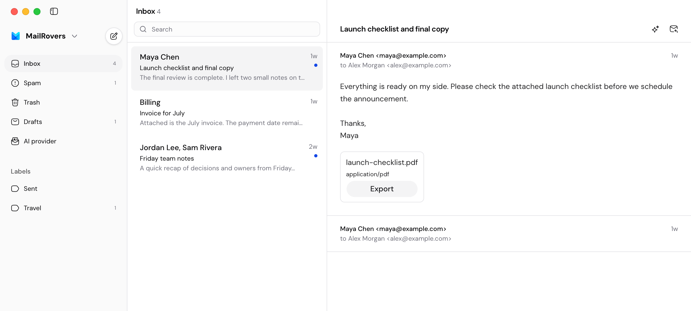
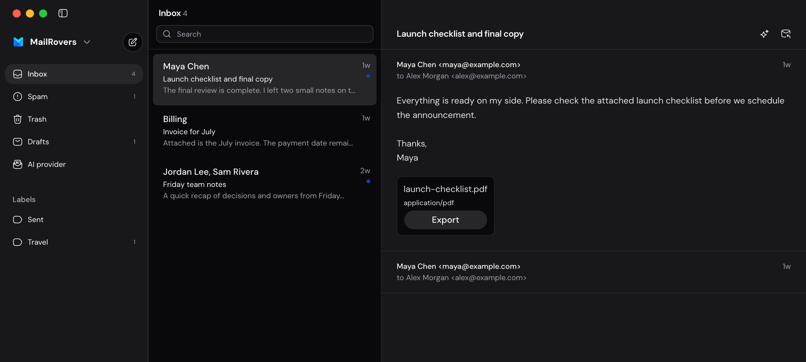

# MailRovers

<p align="center">
  
</p>

<p align="center">
  <a href="#run-the-desktop-app"></a>
  <a href="#how-mailrovers-works"></a>
  <a href="#privacy-and-security"></a>
  <a href="./LICENSE"></a>
</p>

<p align="center">
  
  
</p>

An open-source, local-first desktop email client for Gmail. MailRovers stores mail and
application data on your Mac, connects directly to Gmail, and lets you use your own
OpenAI-compatible AI provider.

MailRovers is from [Rinhelp](https://rinhelp.com), an AI support tool that answers
questions using your website and cites the pages it used.

> [!WARNING]
> MailRovers is alpha software. It currently targets macOS, must be built from source,
> and is not ready for a primary or business-critical inbox.

## Choose a path

| I want to…                                 | Start here                                              |  Typical time |
| ------------------------------------------ | ------------------------------------------------------- | ------------: |
| See the interface without connecting Gmail | [Explore the UI](#explore-the-ui)                       | 10–15 minutes |
| Connect a test Gmail account               | [Run the desktop app](#run-the-desktop-app)             | 20–40 minutes |
| Make a focused contribution                | [Make a contribution](#make-a-contribution)             | 15–30 minutes |
| Understand the design                      | [Read the architecture overview](#how-mailrovers-works) |     5 minutes |

## What works today

- Connect Gmail accounts and resume interrupted local synchronization.
- Browse cached labels and conversations, search with SQLite FTS5, and keep reading offline.
- Compose, reply, save local drafts, send mail, and reconcile mailbox changes.
- Summarize conversations and stream AI-assisted reply suggestions for review.
- Encrypt Gmail refresh tokens and AI API keys with Electron `safeStorage`.

## What is not ready yet

- MailRovers has no signed, notarized, or automatically updating public release.
- Gmail write workflows still need controlled-account release verification.
- AI provider compatibility is not yet verified across a broad provider matrix.
- Synchronization runs only while the desktop app is open.
- Windows, Linux, and non-Gmail providers are not supported.

## Explore the UI

This is the fastest way to explore MailRovers or work on the renderer. The Storybook
workbench uses a typed fake Electron bridge, so it needs no Gmail account, production
database, environment variables, or secrets.

**You need**

- Node.js 22.14 or newer
- pnpm 10.12.1

**Run it**

```sh
pnpm install
pnpm --filter @mailrovers/desktop storybook
```

Open [http://localhost:6006](http://localhost:6006). You should see mailbox, import,
workspace, composer, search, startup, and AI states.

See [`docs/storybook.md`](docs/storybook.md) to find existing scenarios or add a state.

## Run the desktop app

Use a test Gmail account while MailRovers is in alpha.

**You need**

- macOS
- Node.js 22.14 or newer
- pnpm 10.12.1
- A Google Cloud Desktop OAuth client with the Gmail API enabled

1. Follow the [development OAuth setup](docs/gmail-oauth-setup.md#development-setup).
2. Install the workspace dependencies:

   ```sh
   pnpm install
   ```

3. Start MailRovers with your Desktop OAuth credentials:

   ```sh
   MAILROVERS_GOOGLE_OAUTH_CLIENT_ID="your-client-id.apps.googleusercontent.com" \
   MAILROVERS_GOOGLE_OAUTH_CLIENT_SECRET="your-client-secret" \
     pnpm --filter @mailrovers/desktop dev
   ```

The MailRovers window should open. Connect the test Gmail account from the app.

Google issues a client secret for Desktop clients, but it is not confidential in a
distributed desktop app. Set `MAILROVERS_GOOGLE_OAUTH_CLIENT_SECRET` when Google's token
endpoint requires it alongside PKCE. The
[OAuth setup guide](docs/gmail-oauth-setup.md) covers consent-screen configuration,
scopes, branding, development limits, and production verification.

Without `MAILROVERS_GOOGLE_OAUTH_CLIENT_ID`, the app can open local mail, but Gmail
connection returns a configuration error.

### Configure AI

Open **AI provider** in the desktop sidebar and enter:

- An OpenAI-compatible base URL. The default is `https://api.openai.com/v1`.
- A model identifier.
- An API key.

MailRovers uses the provider's Chat Completions streaming endpoint. HTTPS is required
except for loopback providers such as `http://localhost:11434/v1`. The app encrypts the
API key with `safeStorage`; it cannot be read back and is sent only to the configured
provider origin.

## Make a contribution

The credential-free UI workbench is the shortest route to a first contribution.
Read [`CONTRIBUTING.md`](CONTRIBUTING.md) for setup, engineering boundaries, focused
checks, and pull-request expectations. All participation follows the
[`CODE_OF_CONDUCT.md`](CODE_OF_CONDUCT.md).

Good starting areas include:

- Add or improve a UI state in [`apps/desktop/src`](apps/desktop/src).
- Add a Storybook scenario using [`docs/storybook.md`](docs/storybook.md).
- Add focused tests beside an existing package's tests.
- Clarify setup, architecture, or verification documentation.
- Improve keyboard navigation, focus behavior, or accessible labels.

Keep the change focused. Explain what changed and how you verified it in the pull
request. Open a
[change proposal](https://github.com/wilbertliu/mailrovers/issues/new?template=change-proposal.yml)
before changing user behavior, architecture, stored data, or provider contracts.

Report vulnerabilities through [`SECURITY.md`](SECURITY.md). Do not put security details
in an issue or pull request.

### Check your work

Run the smallest relevant check while working, then run the complete check before
opening a pull request:

```sh
pnpm check
```

`pnpm check` verifies formatting, linting, types, tests, and the desktop build.

<details>
<summary>Run checks separately</summary>

```sh
pnpm format:check
pnpm lint
pnpm typecheck
pnpm test
pnpm build
```

Use `pnpm format` to apply the repository's Oxfmt rules.

</details>

<details>
<summary>Native module and packaged performance notes</summary>

`pnpm install` rebuilds `better-sqlite3` for the Electron version pinned by the desktop
app. Database scripts and Vitest use Electron's Node runtime so they share the same
native ABI. Keep the Electron version in `native:rebuild` aligned with the desktop
dependency when upgrading Electron.

For the packaged performance release gate, use the Electron ABI runner, not host-node
`tsx`:

```sh
pnpm performance:packaged
```

Run the pending FTS startup backfill diagnostic with:

```sh
pnpm --filter @mailrovers/desktop performance:packaged:pending-fts
```

`pnpm performance:packaged` runs the full 60-second idle-memory release gate with no
database-host override, so it verifies the worker default. Use
`pnpm performance:packaged:main` only for the main-host rollback diagnostic. Only
`worker` and `main` are accepted; an invalid value stops startup with an actionable error.

</details>

## How MailRovers works

MailRovers has no hosted application server. The Electron app manages synchronization,
mail data, drafts, and AI artifacts locally.

```text
React renderer
      │ validated Electron IPC
Electron main process
      ├── SQLite and FTS5
      ├── Gmail API
      └── OpenAI-compatible API
```

The codebase keeps mail behavior separate from Gmail, storage, Electron, and AI
integrations:

```text
apps/desktop/                 Electron and React desktop application
packages/mail-domain/         Provider-neutral mail domain
packages/mail-contracts/      Transport-neutral contracts
packages/mail-application/    Application facade and use cases
packages/mail-store-sqlite/   Local SQLite storage
packages/provider-gmail/      Gmail OAuth, API access, and payload translation
packages/mail-sync/           Resumable sync and durable command execution
packages/mail-ai/             AI request policy and streaming runtime
packages/platform-electron/   Electron safeStorage adapter
packages/test-support/        Fixtures and test helpers
```

Read [`docs/architecture.md`](docs/architecture.md) for process boundaries, data models,
security rules, performance budgets, and testing strategy.

## Privacy and security

MailRovers is designed so that:

- Gmail refresh tokens and AI API keys never enter the renderer.
- Electron `safeStorage` encrypts credentials before SQLite persistence.
- Gmail and AI requests originate outside the renderer.
- AI receives only the messages needed for the requested operation and cannot send mail.
- A sandboxed frame treats email HTML as untrusted content and blocks scripts and navigation.

## Project status

Core mail and AI workflows are implemented. Public macOS distribution still requires
signing, notarization, automatic updates, and the release checks below.

Before that release:

- Gmail OAuth and write workflows must pass the controlled-account checks in
  [`docs/gmail-release-verification.md`](docs/gmail-release-verification.md).
- AI providers must pass the compatibility and security checks in
  [`docs/ai-provider-verification.md`](docs/ai-provider-verification.md).

## Documentation

| Document                                                                   | Use it for                                        |
| -------------------------------------------------------------------------- | ------------------------------------------------- |
| [`docs/storybook.md`](docs/storybook.md)                                   | UI scenarios and renderer development             |
| [`docs/gmail-oauth-setup.md`](docs/gmail-oauth-setup.md)                   | Gmail development and production OAuth            |
| [`docs/architecture.md`](docs/architecture.md)                             | System design and focused architecture references |
| [`docs/performance-verification.md`](docs/performance-verification.md)     | Packaged performance measurements                 |
| [`docs/gmail-release-verification.md`](docs/gmail-release-verification.md) | Gmail release checks                              |
| [`docs/ai-provider-verification.md`](docs/ai-provider-verification.md)     | AI provider checks                                |
| [`CONTRIBUTING.md`](CONTRIBUTING.md)                                       | Setup, checks, and pull-request expectations      |
| [`CODE_OF_CONDUCT.md`](CODE_OF_CONDUCT.md)                                 | Community standards and reporting                 |
| [`SECURITY.md`](SECURITY.md)                                               | Supported versions and vulnerability reporting    |

## License

MailRovers is available under the [MIT License](LICENSE).
